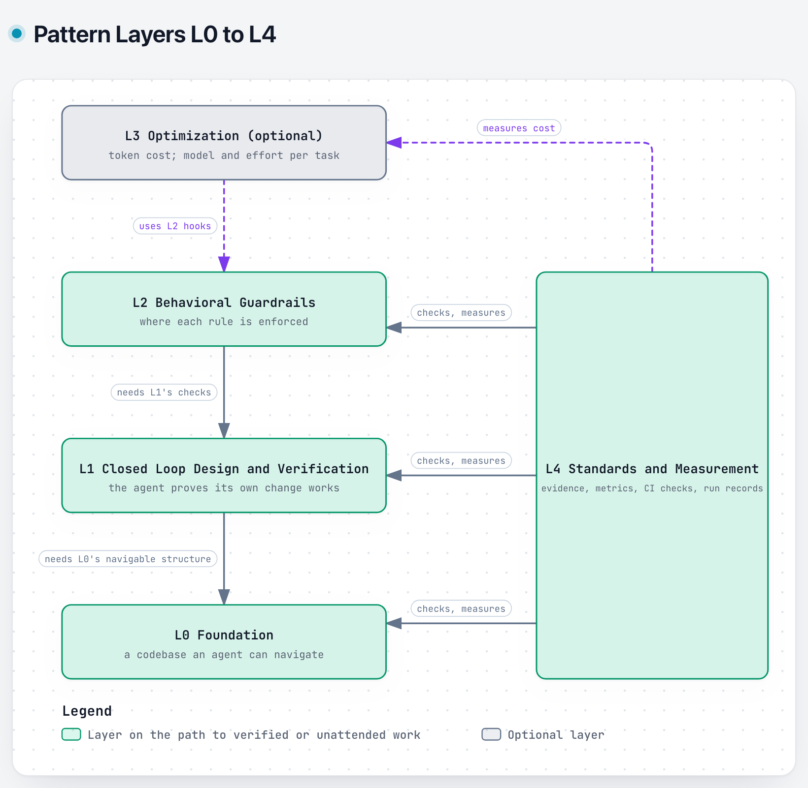

# Agentic Patterns

Patterns and runnable examples for letting AI coding agents change a codebase safely: how to structure a project so
an agent can find its way, how the agent proves a change works, where each rule is enforced, and how far one
workflow may run without a person. For teams using Claude Code or a similar agent harness.

## Start Here

| You are | Read first | First action |
|---------|-----------|--------------|
| A developer who wants safer agent sessions this week | [FAQ: I work alone](docs/cross-cutting/faq.md#i-work-alone-where-does-the-sandbox-settings-file-go), [Pattern 2.9](docs/L2-behavioral-guardrails.md#pattern-29--contain-before-you-relax) | Copy the keys in the [containment binding](examples/containment/README.md#claude-code-binding) into user or managed settings and add your package registries to `allowedDomains`. In a session, `touch ~/outside-tree` and `curl -sI https://example.com` must both fail. Then [Path E](docs/cross-cutting/adoption-guide.md#path-e-one-person-attended-sessions) |
| A lead deciding how far agents may run | [Path D](docs/cross-cutting/adoption-guide.md#path-d-containment-first-teams-moving-to-unattended-work), [The Curve and the Cap](docs/earned-autonomy.md#the-curve-and-the-cap), [threat model](docs/cross-cutting/threat-model.md) | Deliver the sandbox keys to every machine through [managed settings](https://code.claude.com/docs/en/managed-settings) ([Pattern 2.9](docs/L2-behavioral-guardrails.md#pattern-29--contain-before-you-relax)). Then [run the census](examples/autonomy/README.md#run-against-your-own-repository) on one repository with `--json` and read `missing_for_next` per dimension. A repository without this library's files reads C1 |
| A maintainer adding agents to a repository or monorepo with CI | [Pattern 0.4](docs/L0-foundation.md#pattern-04--agent-instruction-file-as-project-constitution), [Pattern 4.5](docs/L4-standards-measurement.md#pattern-45--ci-guardrails), [FAQ: monorepo](docs/cross-cutting/faq.md#monorepo-or-multi-repo-for-agents) | Write a short root AGENTS.md with an owner, a reviewed date and an enforcement point per rule; import it from CLAUDE.md with `@AGENTS.md`; make one unfiltered `tests` job a required check ([how to](docs/cross-cutting/adoption-guide.md#make-the-test-job-a-required-check)) |
| Not sure where the gaps are | [Adoption Guide assessment](docs/cross-cutting/adoption-guide.md#assessment-where-are-you-now) | Pick a path |

## The Pattern Layers

Each layer depends on the ones below it: L1 verification needs L0's navigable structure, and L2 enforcement needs L1's checks. L3 is optional. When unsure, the [adoption guide](docs/cross-cutting/adoption-guide.md) starts with containment, then L0.



### Layer Overviews

**[L0: Foundation](docs/L0-foundation.md)** — A codebase an agent with no prior context can navigate: deep modules, progressive disclosure, one AGENTS.md for every harness, unit tests as contract and aggressive cleanup.

**[L1: Closed Loop Design and Verification](docs/L1-feedback-loops.md)** — How an agent proves its own change works. Stack tests run the whole application in Docker with real dependencies and assert each journey's effects; tests that can pass silently are forbidden. Patterns 1.7 to 1.12 extend the loop to incidents in code you own.

**[L2: Behavioral Guardrails](docs/L2-behavioral-guardrails.md)** — Enforcement points stack. Prose is guidance, command hooks are deterministic policy inside the harness, containment and credentials are the boundary, and skills guarantee nothing. Name the enforcement point for every constitutional rule.

**[L3: Optimization (optional)](docs/L3-optimization.md)** — Lower token cost: native structured tools, blocking destructive shell edits, a scout sub-agent, model and effort per task. Not on the path to verified or unattended work.

**[L4: Standards & Measurement](docs/L4-standards-measurement.md)** — Evidence-based claims, metrics, CI guardrails, context eval, ownership of agent-written code, the team's skill to supervise and run records.

## How the Scales Fit Together

| Scale | Values | Applies to | Question | Defined in |
|-------|--------|-----------|----------|------------|
| Layer | L0 to L4 | Pattern group | What do we build? | [The Pattern Layers](#the-pattern-layers) |
| Enforcement point | prompt, hook, CI, sandbox, downstream | Rule | Where does this rule hold? | [L2](docs/L2-behavioral-guardrails.md) |
| Review tier | low, medium, high, from reversibility (R0-R4) and blast radius (B0-B3) | Change | Who must approve it? | [Risk model](docs/L1-patterns/1.8-reversibility-blast-radius.md#risk-model) |
| Grant, capped by the curve | A1 to A5, capped at C1 to C5 | Workflow, capped per repository | May this workflow act with no person? | [The Grants](docs/earned-autonomy.md#the-grants), [The Curve and the Cap](docs/earned-autonomy.md#the-curve-and-the-cap) |

A grant belongs to one workflow:

| Grant | The agent may | A person still | Needs cap |
|-------|---------------|----------------|-----------|
| A1 | Read and suggest | Applies every change | none |
| A2 | Edit and commit | Pushes, opens the pull request, merges | C2 |
| A3 | Push branches and open pull requests | Merges after required checks | C3 |
| A4 | Act on an event or schedule; merge R0-R1 changes at B0 | Merges every other change; owns the tested stop | C4 |
| A5 | A4, plus R2 at B0 on named paths, managed against a baseline, target, review date and stop rule | Decides at each review | C5 |

This table is the one statement of approvals; the [risk
model](docs/L1-patterns/1.8-reversibility-blast-radius.md#risk-model) defines the classes. Low tier is R0-R2 at B0.

| Class | Review tier | Approvals before a person merges | Merges with no person |
|-------|-------------|----------------------------------|-----------------------|
| R0-R1 at B0 | Low | One, not the requester | At A4 and A5, on required checks |
| R2 at B0 | Low | One, not the requester | At A5, on named paths only |
| R0-R2 at B1 or B2 | Medium | One, not the requester | Never |
| R3 or R4 at any reach, or any class at B3 | High | A code owner plus a second, neither the requester (a rule enforces the second only in organizations) | Never |

Below A4 every tier needs an approval from someone other than the requester, so one person working alone meets none
of them ([Pattern 2.13](docs/L2-behavioral-guardrails.md#pattern-213--risk-tiered-review)). Instruction and tool
configuration files (`CLAUDE.md`, `CLAUDE.local.md`, `AGENTS.md`, `GEMINI.md` and `.mcp.json` at any depth, and anything under a `.claude/` folder except `.claude/settings*.json` and `.claude/hooks/**`)
are medium tier. Only the repair gate classifies a change; for any other A4 workflow, a person or a CI check compares
the pull request's files with the low-tier paths.

Finishing the layers grants nothing. The cap is the lowest of four census dimensions (platform, security and
governance, production ownership, measuring value), and no grant may exceed it. A repository without this library's
files reads C1, which allows only A1. [Reaching C2](docs/earned-autonomy.md#reaching-c2)
lists the four files that allow A2; A3 needs C3, whose probes are explained in [Pattern
A.4](docs/earned-autonomy.md#pattern-a4--census) and [Pattern 4.4](docs/L4-standards-measurement.md#pattern-44--agentic-development-metrics).
The census measures adoption of this library's files and wording, not governance in general.

Grants bind only where you adopt the register (`.autonomy.yaml`) and make `autonomy check` a required check. The
hook's Bash rules are a nudge; the boundary is the tools allow-list, CODEOWNERS, `autonomy check` in CI and
containment. This repository's own agents act above its cap ([Applied to This
Repository](docs/earned-autonomy.md#applied-to-this-repository)). One person working alone can skip the register
([Path E](docs/cross-cutting/adoption-guide.md#path-e-one-person-attended-sessions)).

## What's in This Repo

```text
docs/                 # Layers L0-L4, Earned Autonomy and guides
  cross-cutting/      # Anti-patterns, adoption guide, threat model, FAQ, glossary
  references/         # Case study, further reading, sources, task bank
examples/             # Working code (TypeScript and Python; L3 is TypeScript only)
  stack-test/         # Pattern 1.1: Docker stack tests (typescript/ with Playwright, python/ with pytest)
  repair-loop/        # Patterns 1.7-1.11: incident to reproduction to gate decision, no LLM
  containment/        # Pattern 2.9: policy layer vs container boundary, with tests
  autonomy/           # Patterns A.1-A.6: register check, census, ledger, stop drill, hook
  guardrails/         # Pattern 3.1: optional token-optimization middleware
  project-structure/  # L0: before and after directory layouts (documentation only)
```

## What This Library Does Not Cover

- **Production ownership, in part.** [Pattern 4.7](docs/L4-standards-measurement.md#pattern-47--author-of-record) names an author of record and [Pattern A.5](docs/earned-autonomy.md#pattern-a5--tested-stop) rehearses the stop. On-call, rollback, deployment and production telemetry are not covered; the [FAQ](docs/cross-cutting/faq.md#what-passes-between-the-application-and-operations) states the contract with operations.
- **Comparing outcomes against a baseline.** [Pattern 4.4](docs/L4-standards-measurement.md#pattern-44--agentic-development-metrics) shows the baseline file the census reads, not how to compare against it.
- **Data handling and incident response.** Run records: [Pattern 4.10](docs/L4-standards-measurement.md#pattern-410--observability-of-agent-runs). The rest of security and governance: [Patterns 2.9 to 2.13](docs/L2-behavioral-guardrails.md#pattern-29--contain-before-you-relax) and the [threat model](docs/cross-cutting/threat-model.md).
- **Docker stack tests inside the sandbox.** The [FAQ](docs/cross-cutting/faq.md#my-stack-tests-need-docker-how-do-i-run-them-inside-the-sandbox) compares three options; no example runs one.
- **Monorepos.** The census computes one cap per repository, not per package ([FAQ](docs/cross-cutting/faq.md#monorepo-or-multi-repo-for-agents)).

Covered: the development-time loop (L0 to L4) and the seam where production incidents enter it ([Patterns 1.7 to 1.12](docs/L1-feedback-loops.md#closing-the-loop-in-production), with a runnable gate in [examples/repair-loop](examples/repair-loop/README.md)). Unattended repair of data-forward or irreversible changes is not supported at any grant.

## Origin and Disclosure

The ideas are established (Ousterhout's deep modules, Matt Pocock's graybox modules, progressive disclosure, evidence-based engineering); this library states them as patterns with a check for each.

The patterns were extracted from a [Telegram trading bot](docs/references/reference-telegram-trading-bot-case-study.md): a private application by this library's author that moves funds on blockchains, developed with Claude Code. That project developed **Stack-First Development**: the entire application stack in Docker, tested through API endpoints only, each stack test an atomic user journey. It is one project with no independent replication.

The author also built [rig](https://github.com/franklywatson/claude-rig), a guardrails framework on the L2 to L4 patterns with L3 tool routing; [superpowers](https://github.com/obra/superpowers) provides L2 base skills. rig demonstrates the patterns and does not validate them. Both install hooks, skills and commands that run with your agent's privileges: read and pin before installing ([Pattern 2.12](docs/L2-behavioral-guardrails.md#pattern-212--skill-plugin-and-mcp-supply-chain)).

## Contributing

Welcome: new or challenging patterns, examples from other domains, corrections with the exception documented, and bindings for other harnesses (each L2 pattern's Bindings section states the contract).

## Background and Further Reading

- [Reference Telegram Trading Bot Case Study](docs/references/reference-telegram-trading-bot-case-study.md) — the project these patterns came from
- [Further Reading](docs/references/further-reading.md) — articles, videos, and tools that informed this work
- [Glossary](docs/cross-cutting/glossary.md) — terminology reference
