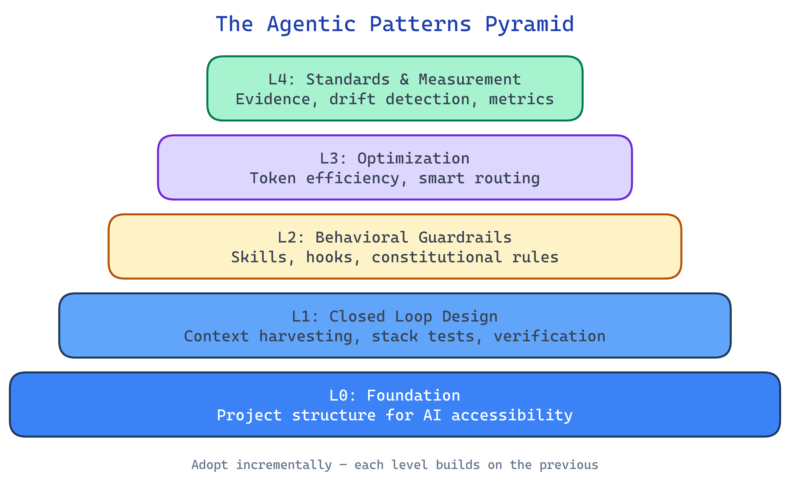

# Agentic Patterns

A toolkit of patterns for making codebases work effectively with AI coding agents — gathered from production use, organized into five layers, and designed to adopt incrementally.

## Why This Exists

AI coding agents are becoming standard tools. But most codebases were built for humans — humans who can mentally bridge gaps, tolerate partial feedback, rely on intuition to navigate messy directories, and instinctively know which warnings to ignore.

AI agents can't do any of that. They need:

- **Complete feedback** — a test either passes or fails, and the failure tells them exactly where to look
- **Structured context** — information organized so complexity is discoverable, not dumped all at once
- **Enforced discipline** — rules that are impossible to bypass, not just written in a wiki
- **Deterministic environments** — no "it works on my machine," no shared state leaking between tests

None of these ideas are new. Deep modules, progressive disclosure, and evidence-based engineering are decades old — drawn from John Ousterhout's work on software design, Matt Pocock's graybox module concept, and well-established testing discipline. What's new is how critical they become when your coworker is an AI with no memory of your codebase and no intuition to fall back on.

These patterns stand on the shoulders of those established ideas. They reframe practices that excellent engineers already use — making them explicit, composable, and enforceable so that agents and humans alike benefit from the structure.

## Where These Patterns Come From

The patterns were extracted from a [production-grade Telegram trading bot](docs/references/reference-telegram-trading-bot-case-study.md) — a financial application handling real blockchain transactions, built fully agentically with Claude Code as the primary development tool. That project developed **Stack-First Development**: bringing up the entire application stack in Docker and testing through API endpoints only, where each stack test is an atomic user journey that passes or fails as a whole.

Peter Steinberger, creator of OpenClaw, has described a similar approach — managing 5-10 parallel agents, closing the feedback loop so agents verify their own work, investing heavily in planning before implementation, and treating code reviews as architecture discussions. His core insight: *"I don't think software engineering is dead with AI: in fact, quite the opposite."* Agentic development demands more engineering discipline, not less.

Other frameworks approach similar problems from different angles. [superpowers](https://github.com/obra/superpowers) provides base skills for brainstorming, planning, TDD, and code review. [rig](https://github.com/franklywatson/claude-rig) is a configurable guardrails framework built on the L2-L4 patterns from this repo — automating enforcement pipelines, tool routing, token-optimized scout agents, context eval, and session management. Install with `rig init`. These systems informed this work — the best available ideas at the time, applied in practice.

Disclosure: the author of this library also built rig, from these patterns. rig demonstrates the patterns. It does not independently validate them.

The lineage: patterns were extracted from the reference project, organized into this library, then used to build rig — to serve as a working reference implementation and configurable toolkit for general use.

### Reference Implementations

| System | What it implements | Language |
|--------|-------------------|----------|
| [rig](https://github.com/franklywatson/claude-rig) | Guardrails framework: L2 enforcement pipeline, L3 tool routing + token-optimized scout agent, L4 context eval, skill chain with phase transitions, CI guardrails. Configurable via `.harness.yaml`. | TypeScript |
| [superpowers](https://github.com/obra/superpowers) | L2 base skills (brainstorming, TDD, verification, review), automated worktree management | Markdown/JS |

## The Pattern Layers

The library has five layers, L0 to L4. A layer is a group of patterns that depend on the layers below it: L1 verification needs the navigable structure of L0, and L2 enforcement needs the checks of L1. The layers are not a maturity scale. Finishing L4 does not make a team ready for unattended agent work. Adoption starts where your gaps are, not at L0 by default.



### Layer Overviews

**[L0: Foundation](docs/L0-foundation.md)** — Structure your codebase so an AI with zero prior context can navigate, understand, and contribute. Deep modules, progressive disclosure, conceptual file organization, an agent instruction file (AGENTS.md) as project constitution, unit tests as contract, documentation as system map, and aggressive cleanup. The "can a new starter figure this out?" test.

**[L1: Closed Loop Design and Verification](docs/L1-feedback-loops.md)** — The layer where agents stop guessing and start designing. Context harvesting gathers targeted evidence before implementation. Design rinsing extends this beyond the current project — extracting distilled architectural understanding from external sources (codebases, transcripts, articles) and translating it into design decisions for the target project. Stack tests validate design intent end-to-end through the full application stack — real dependencies (no mocks in stack tests), no partial integration, no ambiguous results. Mocks are appropriate in unit tests for isolation. Full-loop assertion layering catches regressions at primary, secondary, and tertiary levels of assertion.

**[L2: Behavioral Guardrails](docs/L2-behavioral-guardrails.md)** — Prose is guidance. Hooks are deterministic policy within the harness. Containment and credentials are the boundary. Put each rule at the weakest enforcement point that can hold it, and name that enforcement point for every constitutional rule. Skills overlay project rules on base agent capabilities; the skill chain and phase tracking are optional and scale with risk.

**[L3: Optimization (optional)](docs/L3-optimization.md)** — Reduces tokens spent on exploration and tool output. It is not on the path to verified or unattended work. Covers preferring native structured tools and blocking destructive shell edits, context isolation with a scout sub-agent (from the WISC framework), and a pointer to rig's code for environment-aware routing.

**[L4: Standards & Measurement](docs/L4-standards-measurement.md)** — Evidence-based claims, development metrics, CI guardrails, and context eval for routing effectiveness. Measures whether L0-L3 are holding and what they change. Drift detection and the new-starter audit live in L0 ([Pattern 0.7](docs/L0-foundation.md#pattern-07--documentation-as-system-map) and [Pattern 0.9](docs/L0-foundation.md#pattern-09--ai-as-new-starter-standard)).

## How Far a Team Can Let Go

The layers say whether letting go is safe. Two further scales say how far a team has got and how much one workflow may do on its own. The curve is defined in [Baseline structure](docs/references/sources.md#baseline-structure).

**The curve (C1-C5).** A five-step curve applied separately to each of seven dimensions: C1 Individual, C2 Grounded, C3 Verified delegation, C4 Governed autonomy, C5 Self-correcting. A team has a position per dimension, not one overall score. The steps carry a C prefix so they are not confused with L0-L4.

**Autonomy grants (A1-A5).** A grant is what one named workflow may do. A1 suggests and a human applies the change. A2 opens pull requests that a human reads. A3 passes required checks before a human merges. A4 acts on an event or schedule within permitted actions, with an owner, limits, an audit record and a tested stop, only where verification is mechanical and the action reversible. A5 is A4 managed as an investment: baseline, target, review date and stop rule. Each grant needs a minimum cap, set out below.

**The seven dimensions.** Four of them cap unattended work. The table shows the position a team reaches by adopting every pattern as written. It is a ceiling set by the content, not an assessment of any team.

| Dimension | Position at full adoption | Caps unattended work |
|-----------|---------------------------|----------------------|
| Shared context | C3 | No |
| Team operating model | C3 | No |
| Platform | C2-C3 | Yes |
| Measuring value | C2-C3 | Yes |
| Individual and team skill | C2 | No |
| Security and governance | C2 | Yes |
| Production ownership | C1 | Yes |

The cap line is the lowest position among the four capping dimensions. No workflow grant may sit above it: A2 needs a cap of at least C2, A3 at least C3, A4 at least C4, A5 C5. At full adoption the lowest capping dimension is production ownership at C1, so the cap for unattended work is C1.

## What This Library Does Not Cover Yet

Three dimensions that cap unattended work are not covered, or are covered only in part:

- **Production ownership.** Running and repairing agent-built software in production, including on-call and rollback. The [FAQ](docs/cross-cutting/faq.md) names it as out of scope.
- **Security and governance.** L2 covers enforcement and containment. It does not cover supply-chain controls, data handling, audit retention or approval policy.
- **Measuring value against a baseline.** L4 describes metrics. It does not describe how to set a baseline before adopting a pattern or how to compare against it afterwards.

What is covered: the development-time loop (L0 to L4), and the seam where production incidents enter it. [Patterns 1.7 to 1.12](docs/L1-feedback-loops.md#closing-the-loop-in-production) define the incident record, reproduction, classification, gate, limits and stop for repairing owned code. What is out of scope: deployment pipelines, feature-flag services and production telemetry. The [FAQ](docs/cross-cutting/faq.md#what-passes-between-the-application-and-operations) defines the contract between the application and operations. Unattended repair of data-forward or irreversible changes is not supported at any grant.

The consequence: production ownership sets the cap for unattended work. A team that adopts every pattern in this library has it at C1, so it is capped at C1. Closing the security and governance gap or the measurement gap alone does not raise the cap, because production ownership stays at C1. Closing production ownership alone raises it only to C2 (security and governance).

## Getting Started

1. **New to agentic development?** Start with [L0: Foundation](docs/L0-foundation.md). Structural changes there are the cheapest to make and every later pattern builds on them; no study measures their impact relative to other patterns.
2. **Already using AI coding tools?** Jump to [L1: Closed Loop Design and Verification](docs/L1-feedback-loops.md) to understand how context harvesting and closed-loop verification improve agent outcomes.
3. **Building team practices?** [L2: Behavioral Guardrails](docs/L2-behavioral-guardrails.md) and [L4: Standards & Measurement](docs/L4-standards-measurement.md) together establish the discipline layer.
4. **Looking for adoption paths?** See the [Adoption Guide](docs/cross-cutting/adoption-guide.md) for suggested approaches — not a rigid plan, but a set of paths teams have found useful.

## Audience

- **Solo developers and small teams** using Claude Code, Cursor, or similar tools — adopt patterns incrementally, starting where your gaps are
- **Team leads and architects** exploring agentic development practices for their organization
- **Anyone** curious about what "agentic-friendly" software engineering looks like in practice

## What's in This Repo

```
docs/               # Pattern documentation (layers L0-L4) and guides
examples/           # Working code examples (TypeScript + Python for core patterns; the optional L3 example is TypeScript only)
  stack-test/
    typescript/     # Jest-based stack tests + Playwright browser tests
                    #   Demonstrates: API-level AND browser-driven verification
                    #   Stack: Node.js + PostgreSQL + Redis in Docker
    python/         # pytest-based stack tests (API-level only)
                    #   Demonstrates: API-level verification, Python conventions
                    #   Stack: Python + PostgreSQL + Redis in Docker
  guardrails/       # Optional L3 token optimization middleware (TypeScript only)
                    #   Intent classification, tool routing, environment detection
  project-structure/ # Before/after directory layouts
docs/cross-cutting/ # Anti-patterns, adoption guide, FAQ, glossary
docs/references/    # Case study (trading bot) and further reading
```

The TypeScript and Python stack-test examples cover the same core pattern (Docker-based stack tests with full-loop assertions) but differ in scope: the TypeScript example extends to browser-based testing with Playwright, while the Python example demonstrates API-level testing with pytest conventions. Both are self-contained and runnable independently.

## Contributing

This is a living pattern library. Contributions welcome:

- **New patterns** that extend or challenge the existing framework
- **Real-world examples** from different domains (the current examples lean toward ecommerce and trading)
- **Corrections** when a pattern doesn't match your experience — document the exception
- **Translations** of concepts to other frameworks and tools

## Background and Further Reading

- [Reference Telegram Trading Bot Case Study](docs/references/reference-telegram-trading-bot-case-study.md) — the production system these patterns were extracted from
- [FAQ](docs/cross-cutting/faq.md) — deployment, operations, and other SDLC concerns beyond the patterns
- [Further Reading](docs/references/further-reading.md) — articles, videos, and tools that informed this work
- [Glossary](docs/cross-cutting/glossary.md) — terminology reference
