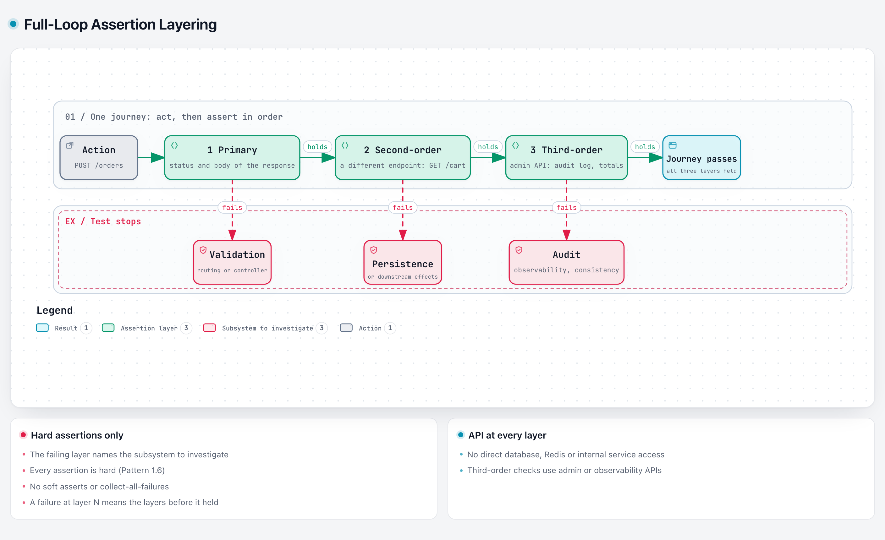

# Pattern 1.2 — Full-Loop Assertion Layering

Assert on every effect of an action in three ordered layers, so the first failure names the subsystem. Read it when
a stack test passes and production still breaks.



## Problem

A test that asserts only on status codes gives false confidence. A `200 OK` means the API did not crash, not that the
database was updated, the cache invalidated, the audit entry written or the event published. When such a test does
fail, shallow assertions make the cause hard to find.

## Solution

**Full-loop assertion layering** orders checks in three layers of increasing distance from the primary action:

1. **Primary**: the direct API response (status, body structure, immediate fields).
2. **Second-order**: derived effects verified through a different API endpoint than the one that performed the
   action. Create a user with POST, then confirm it through the list endpoint. This proves the data was persisted,
   not only that the operation returned a success object.
3. **Third-order**: cross-functional effects verified through administrative or observability APIs: audit logs,
   notifications, cross-endpoint consistency, authentication enforcement.

The layers are an **ordering for diagnosis**, not a way to soften failures. Every assertion is a hard assertion
([Pattern 1.6](1.6-test-integrity.md)): the first failure stops the test and the failing layer names the subsystem to
investigate. Primary fails: validation, routing or controller logic. Second-order fails: the controller works but
persistence or downstream effects do not. Third-order fails: the core path works but audit, observability or
cross-endpoint consistency does not. A failure at layer N tells the agent that the layers before it held.

## In Practice

A "user places an order" journey with three layers:

```typescript
// Primary: the API response
const orderResponse = await api.post('/orders', {
  items: [{ productId: 'prod_123', quantity: 2 }],
  shippingAddress: { zip: '90210', country: 'US' },
});
expect(orderResponse.status).toBe(201);
expect(orderResponse.data.orderId).toBeDefined();

// Second-order: a different endpoint than the one that created the order
const cart = await api.get(`/cart/${userId}`);
expect(cart.data.items).toEqual([]);

// Third-order: the audit pipeline, through the admin API
const auditLog = await createAdminClient().get(`/audit/${orderResponse.data.orderId}`);
expect(auditLog.data.event).toBe('ORDER_PLACED');

// Third-order: cross-endpoint consistency
const summary = await api.get(`/orders/${orderResponse.data.orderId}/summary`);
expect(summary.data.total).toBe(orderResponse.data.total);
```

## Anti-Pattern

**Don't** skip the second and third layers "to save time." Each catches a class of failure the previous layer cannot,
and a bug in a skipped layer surfaces in production.

**Don't** implement any layer by querying databases directly. Use the API, even an admin-only one. Tests act like
users or admins, not like developers with database access, so a stack test has no direct database, Redis or internal
service access.

**Don't** wrap a later layer so that it runs after an earlier one failed. The first failing assertion ends the test;
`softAssert` and collect-all-failures styles are forbidden by [Pattern 1.6](1.6-test-integrity.md). To see what else
is broken, fix the failure and rerun, or split the layers into separate journeys.

## Cross-References

- [Pattern 1.6 — Test Integrity Rules](1.6-test-integrity.md): every assertion is hard and unconditional
- [Pattern 1.3 — Sequential / Additive Test Design](1.3-sequential-design.md): ordering across tests, as layering orders assertions within one

**Evidence:** Thin — layering is a trading-bot design (this project's own experience, n=1); the closed-loop principle it serves rests on vendor guidance (OM-7, OM-9)

---

[Back to L1 Overview](../L1-feedback-loops.md) | [Previous: Pattern 1.1](1.1-stack-tests.md) | [Next: Pattern 1.3](1.3-sequential-design.md)
