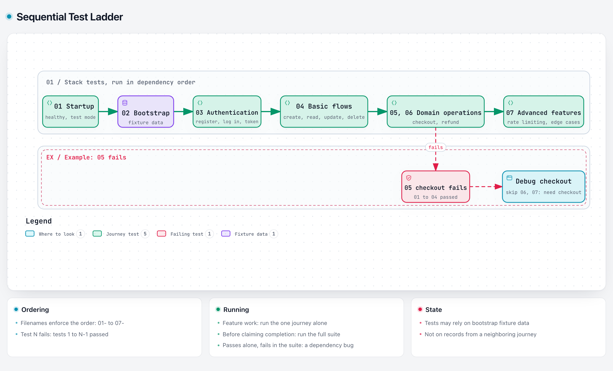

# Pattern 1.3 — Sequential / Additive Test Design



## Problem

Tests that run in unpredictable order make failures hard to diagnose. If a complex order test fails, is the bug in
checkout, in authentication, or in a server that never started? Agents then debug symptoms instead of root causes.

## Solution

**Sequential/additive test design** orders tests by dependency: each test assumes the earlier ones pass. The sequence
is a diagnostic ladder: if test N fails, tests 1 through N-1 passed, which narrows the search.

Standard ordering, each step a user journey that builds on the previous ones:

1. **Startup**: the system comes online and reports healthy; the health endpoint runs in test mode
   ([Pattern 1.1](1.1-stack-tests.md#health-endpoint-test-mode)).
2. **Bootstrap**: fixture data is loaded: seed users, pre-configured resources, reference data.
3. **Authentication**: a user registers, logs in and receives a valid session token.
4. **Basic flows**: a user creates, reads, updates and deletes resources.
5. **Domain operations**: a domain workflow completes (checkout, refund, export).
6. **Advanced features**: edge cases and complex multi-step workflows.

## In Practice

Filenames enforce the order:

```
tests/stack/
  01-app-startup.stack.test.ts
  02-bootstrap-test-data.stack.test.ts
  03-authentication.stack.test.ts
  04-user-crud.stack.test.ts
  05-checkout-complete.stack.test.ts
  06-refund-and-reconciliation.stack.test.ts
  07-rate-limiting.stack.test.ts
```

If `05-checkout-complete.stack.test.ts` fails:

- The agent knows startup (`01`), bootstrap (`02`), authentication (`03`) and CRUD (`04`) passed.
- The agent focuses on checkout logic, not auth or persistence.
- The agent can skip refunds (`06`) and rate limiting (`07`), which depend on a working checkout.

### Vertical slices

Each stack test is a vertical slice, like a user story: it cuts through API, database and external services for one
journey. During feature work, run the single journey (`05-checkout-complete` alone) for fast feedback. Run the full
suite before claiming completion. A test that passes alone but fails in the suite reveals a dependency bug.

### Additive tests as comparative ground truth

A passing foundational test is executable ground truth for diagnosing a failing new one. Say a
`user-order-completion` test passes (login, pick an item, pay, then assert order state through `/user/orders`, the
email sent and the payment debit). The agent then implements return-label printing with a new stack test, and the
test fails in unclear ways.

Have the agent diff the passing test against the failing one, with the logs and code for order creation and terminal
state. In this project's experience, the diff shows a convention mismatch: a different bootstrap user, the wrong service
creating the order, or a terminal-state assertion that checks the label exists but not that it is legible. The agent aligns the new
work with the conventions the earlier test established.

## Anti-Pattern

**Don't** let a domain test depend on state another domain test left behind. A test may depend on bootstrap fixture
data, because later tests assume the bootstrap tests passed. It may not depend on records created by a neighboring
journey. Create fresh state in `beforeEach` or inside the journey.

**Don't** put unrelated tests in the middle of the sequence. A test that does not fit the dependency ladder belongs in
another suite or at the unit level.

## Cross-References

- [Pattern 1.4 — Container Isolation](1.4-container-isolation.md): each run gets its own isolated stack, which also makes concurrent suites safe

**Evidence:** Thin — ordering as a diagnostic ladder is reasoned, not measured (this project's own experience, n=1)

---

[Back to L1 Overview](../L1-feedback-loops.md) | [Previous: Pattern 1.2](1.2-full-loop-assertions.md) | [Next: Pattern 1.4](1.4-container-isolation.md)
