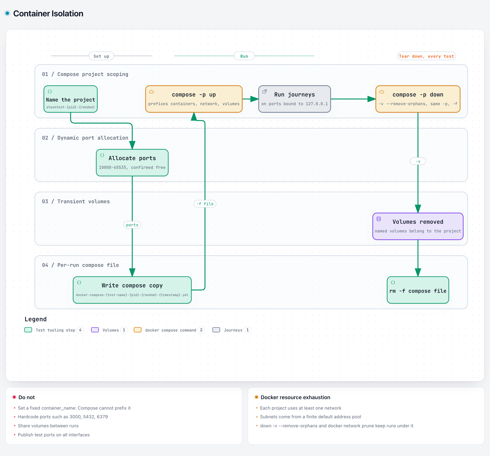

# Pattern 1.4 — Container Isolation

Give each test run its own compose project, ports and volumes, so concurrent runs never collide. Read it when tests
pass alone and fail in parallel or in CI.



## Problem

Concurrent Docker-based tests collide: containers share names, ports conflict, volumes leak state, and Docker runs
out of networks and address space. Tests pass alone and fail in parallel, CI turns flaky, and the agent spends tokens
on false investigations.

## Solution

**Container isolation** uses four mechanisms so that concurrent runs share no names, ports, volumes or files:

1. **Compose project scoping**: run each stack with `docker compose -p <unique project>`, for example
   `stacktest-{pid}-{random}`. Compose prefixes the project name onto every container, network and volume. The
   examples in `examples/stack-test/` use this and set no fixed `container_name`.
2. **Dynamic port allocation**: pick ports at random from a range (10000-65535) and keep only ports confirmed free.
3. **Transient volumes**: named volumes belong to the project and disappear with `docker compose -p <project> down -v`.
4. **Per-run compose file** when the file is generated: `docker-compose-{test-name}-{pid}-{random}-{timestamp}.yml`
   keeps generated files from overwriting each other.

A fixed `container_name` defeats project scoping, because Compose cannot prefix it. Leave it unset.

Isolation also limits **Docker resource exhaustion**. Docker draws bridge-network subnets from a finite default address pool
(configurable with `default-address-pools`, see the [dockerd reference](https://docs.docker.com/reference/cli/dockerd/)),
and each Compose project uses at least one network. Past the limit, network creation fails with "could not find an available, non-overlapping IPv4 address pool".
Teardown with `down -v --remove-orphans` and `docker network prune` keeps concurrent runs under it.

## In Practice

The allocator tries random ports, checks each with `lsof` or `ss` (TypeScript) or by binding to it (Python), and throws after a fixed number of failed attempts;
see `allocatePorts` and `isPortAvailable` in
[`examples/stack-test/typescript/tests/config/stack-utils.ts`](../../examples/stack-test/typescript/tests/config/stack-utils.ts).
The example substitutes the allocated ports into a copy of `docker-compose.test.yml`, and the compose file sets
no `container_name`.

Start and clean up with the same project name and the same compose file:

```bash
project="stacktest-$$-$(openssl rand -hex 4)"
docker compose -p "$project" -f "$compose_file" up -d --build --wait
# ... run the journeys ...
docker compose -p "$project" -f "$compose_file" down -v --remove-orphans   # in every test's cleanup
rm -f "$compose_file"
```

## Anti-Pattern

**Don't** use hardcoded ports such as `3000`, `5432` or `6379`. They collide on a developer machine and in CI.

**Don't** share volumes for "performance." State leakage causes flaky tests, and transient volumes are only slightly
slower.

**Don't** rely on Docker's auto-cleanup. Networks and orphaned containers accumulate, so remove them explicitly in
every test's teardown.

**Don't** publish test ports on all interfaces. Bind them to `127.0.0.1`, as the example compose files do.

## Cross-References

- [Pattern 1.1 — Stack Tests](1.1-stack-tests.md): isolation lets stack tests run concurrently, and the isolation helpers are production code ([Stack tooling is production code](1.1-stack-tests.md#stack-tooling-is-production-code))

**Evidence:** Partial — mechanism argument: unique project names and ports remove collisions; the network limit comes from the finite default address pool and is not measured here (this project's own experience, n=1)

---

[Back to L1 Overview](../L1-feedback-loops.md) | [Previous: Pattern 1.3](1.3-sequential-design.md) | [Next: Pattern 1.5](1.5-real-dependencies.md)
