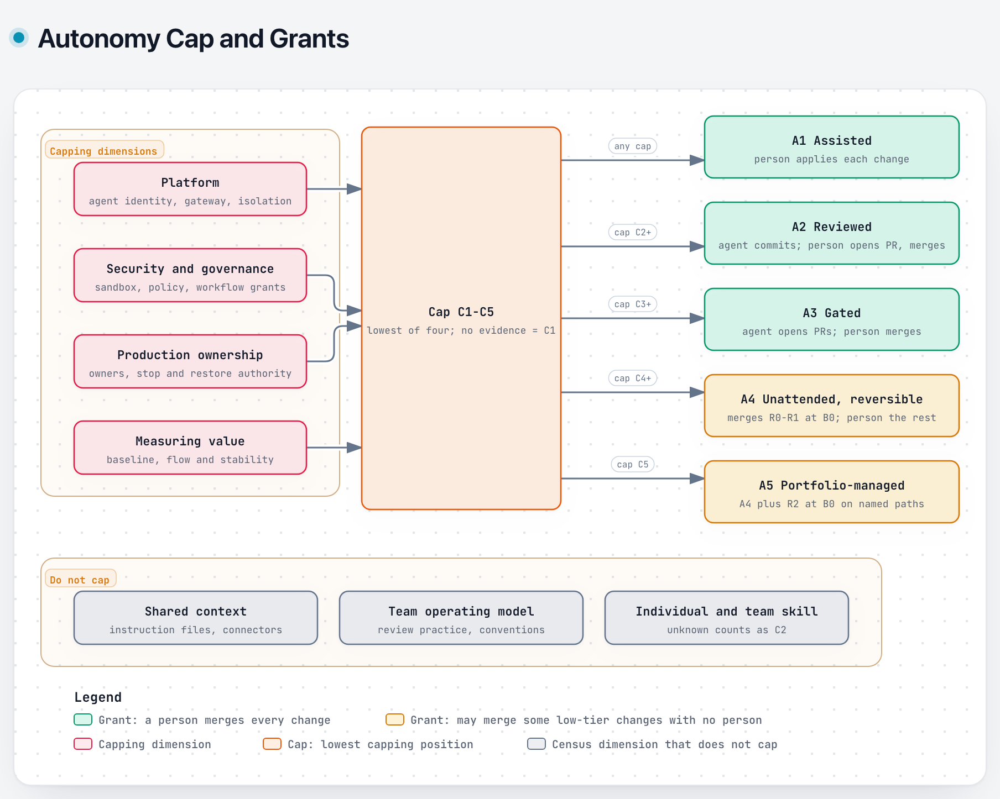

# Earned Autonomy

This guide is for whoever decides how much an agent workflow may do without a person. A grant (A1 to A5) is what
one workflow may do; a named person gives it on CI evidence, and it falls automatically when the evidence stops. The
cap (C1 to C5) is the highest grant a repository allows, computed by a census of its files. Grants bind only where a
repository adopts the register and makes `autonomy check` a required check. A repository without this library's
files reads C1, which allows read-only A1; [Reaching C2](#reaching-c2) lists the four files that allow edits.

Evidence is uneven. The grants A1 to A3 match published tiered-autonomy models (SG-26, SG-6). A4, A5, the curve, the
grid, the cap rule, promotion, demotion, the census and the stop drill are this library's design, drawn in part from
the author's unpublished [research baseline](references/sources.md#baseline-structure); no study validates them.
Every threshold is illustrative: tune it from your own ledger. Source IDs resolve on [the sources page](references/sources.md).

## The Curve and the Cap

The curve places one repository on each of seven dimensions. The census ([Pattern A.4](#pattern-a4--census)) writes
the profile and `autonomy check` compares the register with it. Run the census at the repository root, never per
package, so a monorepo gets one cap; a workflow that acts in several repositories needs a grant within the cap of
each. The top of the curve is the ability to raise a named workflow's grant on evidence, show the evidence, and lower
it again, not "most agents" or "no humans".

### The Curve

| Position | Name | Defined by |
|----------|------|------------|
| C1 | Individual | People use AI as they choose. Nothing is shared or committed. |
| C2 | Grounded | Approved tools, committed shared context, and every agent change read by a human. |
| C3 | Verified delegation | Autonomy chosen per task. Agent changes pass automated checks before a human sees them. Skills and instructions are versioned and reviewed. Every agent change has a named owner. |
| C4 | Governed autonomy | Agents run unattended on events, schedules or a backlog, each workflow with an owner, permitted actions, limits, an audit record and a tested stop. Controls are enforced by the system. |
| C5 | Self-correcting | Workflows are managed as a portfolio with cost, value, risk and a review date, and some are retired. Autonomy is extended or withdrawn per workflow on evidence. Shared context is pruned as well as grown. |

### The Grid

The [sources page](references/sources.md#chapters) names the baseline chapter behind each row.

| Dimension | C1 | C2 | C3 | C4 | C5 |
|-----------|----|----|----|----|----|
| Platform | Personal keys; agents cannot be listed | Agents and keys listed and mapped to teams | Agent identity from a template; one gateway; a check command CI runs | Isolation by default; delegated actions audited; loop alerts | Contribution path for tools and skills; vendor change touches configuration only |
| Shared context | Knowledge in heads and chats | Instruction files committed, often long and untested | Short, owned, tested files; hard rules in hooks | Governed connectors; permissions enforced at query time | Layered, owned, expiring; re-baselined when models change |
| Team operating model | Private use; no stated stance | Written stance; one human review per PR | Conventions as checks; automated plus human review | Review depth by risk; sandboxed loops; agent first-pass on incidents | Unattended work routine; process retired when its gap closes |
| Security and governance | Unvetted tools; broad access | Policy written; nearly every prompt approved | Sandboxed, scoped, vetted; agent PRs pass the same gates | Grants per workflow; risky combinations gated; deterministic policy | Controls tested against adaptive attacks; grants change with evidence |
| Production ownership | Nobody can list or stop agents | Inventory with individual owners | Sponsor per agent; expiring access; human author of record | Changes eval-gated and versioned; stop and restore authority assigned | Automatic handover and retirement; shared tooling owned as a product |
| Individual and team skill | Habit; nobody can say how output is checked | Engineers state what they hand over | Output checked against specs and tests; debugging practiced; reviewed skills shared | Work broken down for unattended agents; supervision by outcome and exception; failure drills | Pruning, protected practice, autonomy raised only with feedback loops |
| Measuring value | Counting use | Measuring speed | Flow and stability against a baseline | Task banks, leading indicators, maintained configuration | Baseline, target, review date and stop rule per investment |

### The Cap Rule

Four dimensions cap unattended work: platform, security and governance, production ownership and measuring value.
The cap is the lowest position among those four, and no grant may exceed it: a repository at C4 on operating model and
C2 on production ownership has a cap of C2. The cap has no exception field: a grant above it is a configuration
error, and `autonomy check` fails the CI job ([Pattern A.3](#pattern-a3--promotion-demotion-and-the-cap-gate)).



The cap comes from the repository's own census and fails closed. A capping dimension that is absent from the profile,
invalid or without evidence counts as C1. A missing profile, or one whose `generated` time is missing, not an ISO 8601
date or time, or later than the current time, caps at C1. Only individual skill, which no file shows, can be `unknown`; it counts as C2 and does not cap.

### Reaching C2

A repository that has adopted none of the files below is at C1 on the four capping dimensions, so only A1 is
allowed; a session that edits files needs A2 and a cap of C2. Each capping dimension reaches C2 when one probe of the
example census passes:

| Dimension | Probe | Passes when | What it takes |
|-----------|-------|-------------|---------------|
| Platform | `agent-config` | `.claude/`, `AGENTS.md` or `.harness.yaml` exists | One committed file or directory |
| Security and governance | `constitutional-rules` | "constitutional" appears in CLAUDE.md, in an AGENTS.md that CLAUDE.md imports with `@AGENTS.md`, or in AGENTS.md when there is no CLAUDE.md | A rules section whose rules each name an enforcement point ([Pattern 2.4](L2-behavioral-guardrails.md#pattern-24--constitutional-rules)) |
| Production ownership | `register-owners` | `.autonomy.yaml` lists at least one workflow and each has an owner | A register entry per workflow with an owner who accepts the role; `interactive` is listed or set by `defaults.interactive_level` ([Pattern A.1](#pattern-a1--autonomy-register)) |
| Measuring value | `outcome-tracking` | `.autonomy/baseline.json` or a `.jsonl` file in `.autonomy/ledger/` exists | A first baseline of flow and stability numbers, written with the recipe in [Pattern 4.4](L4-standards-measurement.md#pattern-44--agentic-development-metrics) |

Commit the four together, then run `autonomy census` and `autonomy check`. A register that omits `interactive` grants
it A2 (`defaults.interactive_level`), so `check` fails until the cap reaches C2. C2 allows A2 only: a workflow that
pushes branches or opens pull requests is A3 and needs C3 on all four capping dimensions. [Pattern
A.4](#pattern-a4--census) says what a passed probe proves and links the C3 probes.

## The Grants

A grant belongs to one workflow, not to an agent or a team. One agent may run several workflows at different grants.
An interactive developer session is a workflow too.

| Grant | Name | What the workflow may do | Needs a cap of at least |
|-------|------|--------------------------|-------------------------|
| A1 | Assisted | Suggest, with read-only tools. A human applies the change. | none |
| A2 | Reviewed | Edit files and commit in a working tree. A human reads every change, pushes the branch and opens the pull request. | C2 |
| A3 | Gated | Pushes branches and opens pull requests. Changes pass required checks before a human sees them. A human merges. Every change has a named owner. | C3 |
| A4 | Unattended, reversible | Acts on an event, schedule or backlog within its permitted actions, and may merge with no human. Has an owner, limits, an audit record and a tested stop. | C4 |
| A5 | Portfolio-managed | A4 plus a baseline, a target, a review date and a stop rule. The grant moves on evidence. The workflow can be retired. | C5 |

A4 applies only where verification is mechanical and the action is reversible. The [risk
model](L1-patterns/1.8-reversibility-blast-radius.md#risk-model) states which classes merge with no person at A4 and
A5 and how they pass a required review. Only the repair gate classifies a change; `permitted_actions.paths` does
not keep an A4 merge low-tier, because the hook checks the session's working tree, not the pull request. For any
other A4 workflow, a person or a required CI check compares the pull request's files with the low-tier paths. The
register stores a grant as a number (`granted_level: 4` is A4).

### Why Stack Tests Earn Autonomy

In this library, stack tests earn autonomy. A4 requires mechanical verification: a machine, not the agent and
not a tired reviewer, decides whether the change worked. That holds only where the workflow's user journey has a stack
test ([Pattern 1.1](L1-patterns/1.1-stack-tests.md)) with full-loop assertions ([Pattern
1.2](L1-patterns/1.2-full-loop-assertions.md)) that cannot pass silently ([Pattern
1.6](L1-patterns/1.6-test-integrity.md)). Without one, verification is partial or a matter of judgment, and the
workflow stays at A3 or below however long it has run cleanly.

**Evidence:** Partial — vendor guidance on giving agents a check to run, and one company's unattended maintenance
where checks are mechanical; the A4 rule is this library's design (AN-3, OM-9, MC-21)

## Prerequisites by Grant

A grant needs its row, every row above it and the cap in [The Grants](#the-grants).

| Grant | Layer patterns | Containment and ownership patterns | Patterns in this guide |
|-------|----------------|------------------------------------|------------------------|
| A2 | [0.2](L0-foundation.md#pattern-02--progressive-disclosure) progressive disclosure, [0.4](L0-foundation.md#pattern-04--agent-instruction-file-as-project-constitution) agent instruction file, [0.6](L0-foundation.md#pattern-06--git-worktree-based-development) worktrees, [0.7](L0-foundation.md#pattern-07--documentation-as-system-map) docs as system map, [2.4](L2-behavioral-guardrails.md#pattern-24--constitutional-rules) constitutional rules | Register with owners (A.1), [4.7](L4-standards-measurement.md#pattern-47--author-of-record) author of record | A.1 |
| A3 | [0.5](L0-foundation.md#pattern-05--unit-tests-as-contract) unit tests as contract, [1.1](L1-patterns/1.1-stack-tests.md) to [1.6](L1-patterns/1.6-test-integrity.md) stack tests and test integrity, [2.3](L2-behavioral-guardrails.md#pattern-23--hook-automation) hooks and check composition, [2.5](L2-behavioral-guardrails.md#pattern-25--zero-defect-tolerance) zero-defect, [4.1](L4-standards-measurement.md#pattern-41--evidence-based-claims) evidence-based claims, [4.5](L4-standards-measurement.md#pattern-45--ci-guardrails) CI guardrails as required checks | [2.9](L2-behavioral-guardrails.md#pattern-29--contain-before-you-relax) contain before you relax, [2.12](L2-behavioral-guardrails.md#pattern-212--skill-plugin-and-mcp-supply-chain) supply chain, [2.13](L2-behavioral-guardrails.md#pattern-213--risk-tiered-review) risk-tiered review, a non-author approval rule, a human author-of-record trailer | A.2 |
| A4 | [4.4](L4-standards-measurement.md#pattern-44--agentic-development-metrics) metrics with thresholds and owners, [4.6](L4-standards-measurement.md#pattern-46--context-eval) context eval as a task bank | [2.10](L2-behavioral-guardrails.md#pattern-210--least-agency-and-session-composition) least agency (trifecta gate), [2.11](L2-behavioral-guardrails.md#pattern-211--agent-identity-and-delegation) agent identity, register entries with sponsor, expiry and stop authority | A.3, A.4, A.5, A.6 |
| A5 | [2.8](L2-behavioral-guardrails.md#pattern-28--compound-engineering) compound engineering with pruning, [0.8](L0-foundation.md#pattern-08--aggressive-cleanup) aggressive cleanup applied to skills and rules, [0.9](L0-foundation.md#pattern-09--ai-as-new-starter-standard) new-starter standard | A retirement record per workflow | A.3 review |

Layer L3 is on no row. It reduces cost per outcome, which A5 reports, but it is not a safety prerequisite at any grant.

## Pattern A.1 — Autonomy Register

### Problem

Autonomy is granted implicitly. Whoever configures a scheduled agent or turns on auto-merge decides, and nobody can list what runs, at what grant, or who can stop it.

### Solution

One committed, schema-validated file per repository, `.autonomy.yaml`, lists every agent workflow and its grant. It is a locked file: no agent commit may change it (Pattern A.6).

Each entry records the owner, an accountable sponsor, the grant, a non-personal identity, permitted and forbidden
actions, a risk class, limits, the stop mechanism with the date it was last tested, and a review date. A5 adds a
baseline, a target and a stop rule. [Pattern A.6](#pattern-a6--enforcement-through-hooks) says which fields the hook
enforces; the rest are records.

### In Practice

```yaml
# .autonomy.yaml
version: 1
defaults: { interactive_level: 2, stop_test_max_age_days: 30 }
profile: .autonomy/profile.json   # written by `autonomy census`; never hand-edited; must stay inside .autonomy/

workflows:
  - id: dep-bump
    owner: team-platform            # should resolve in CODEOWNERS
    sponsor: "@alice"               # accountable human
    granted_level: 4                # A4
    identity: github-app:deps-bot   # non-personal, short-lived token
    access_expires: 2027-02-01
    permitted_actions:
      tools: ["Read", "Edit", "Bash(npm install*)", "Bash(npm test*)", "Bash(git *)", "Bash(gh pr *)"]
      paths: ["package.json", "package-lock.json"]
      git: [branch, commit, open_pr, auto_merge]
      network: ["registry.npmjs.org"]
    forbidden_actions: [deploy, read_secrets, force_push, edit_ci, edit_autonomy]
    risk:
      reversible: true              # a revert undoes the action
      verification: mechanical      # mechanical | partial | judgement
      blast_radius: repo            # file | repo | service | external
      trifecta: { untrusted_input: true, sensitive_data: false, external_action: false }
    limits: { max_runs_per_day: 5, max_cost_usd_per_run: 2.00, max_diff_lines: 400 }
    stop:
      mechanism: "gh workflow disable deps-bot.yml; revoke app installation token"
      command: 'touch "$AUTONOMY_STOP_FILE"'   # the drill runs it and checks the canary stopped
      authority: ["team-platform", "@oncall"]
      last_tested: 2026-11-02       # written by the stop drill, not by hand
    review_date: 2027-02-01
```

The schema rules for each grant are in [the example README](../examples/autonomy/README.md#the-register). No tool
checks that a sponsor is current; whether each owner appears in CODEOWNERS is a census probe, not a check.

Keep the register apart from the harness configuration: they have different owners, and mixing them lets a routine harness edit change a grant.

### Anti-Pattern

- A register that lists agents instead of workflows. The same agent runs a low-risk and a high-risk job; one entry hides the difference.
- A register an agent can edit. It can then promote itself.
- Interactive sessions left off the list. They are workflows too, and the one most developers run.

**Evidence:** Partial — tiered, per-workflow grants appear in analyst and preprint models, and ownership with expiring access appears in vendor identity governance; the register schema is this library's design (SG-6, SG-26, PO-10, PO-11)

## Pattern A.2 — Evidence Ledger

### Problem

Promotion on "consecutive successes" raises a question: who records success? If the agent does, it is self-report, and agents mark work complete when it is not (IS-15, OM-9). Completion evidence comes from systems the
agent cannot edit ([Pattern 4.1](L4-standards-measurement.md#pattern-41--evidence-based-claims)).

### Solution

An append-only ledger per workflow, written only by CI and by scheduled jobs that observe source control afterwards. One JSON line per run. The agent never writes it.

### In Practice

```json
{"run":"gh-123456","ts":"2026-11-18T03:12:00Z","workflow":"dep-bump","level":4,
 "model":"claude-opus-5-5","harness_hash":"sha256:9f1c...","outcome":"merged",
 "checks":{"unit":"pass","stack":"pass","context-eval":0.94},
 "first_run_pass":true,"human_interventions":0,"diff_lines":212,"cost_usd":0.83,
 "reverted_at":null,"rework_commits_14d":0,"escaped_defect":false}
```

The ledger is `<workflow>.jsonl` on a bot-only branch, which keeps the main branch history clean. The census and
`autonomy ledger` read only `.autonomy/ledger/` in the working tree, so the CI job checks the branch out there first
([command](../examples/autonomy/README.md#ledger)).

Three fields arrive late. A nightly job fills `reverted_at` (it scans for reverts), `rework_commits_14d` (follow-up commits touching the same lines) and `escaped_defect` (issues linked to the merge commit). Revert count alone is easy to game: do not revert. Rework and escaped defects close that gap.

`harness_hash` covers the model id, the effort level, the agent instruction file, `.claude/**`, skills, hooks and the
harness configuration. A change to it is a release of the workflow. The workflow is capped at A3 until its [task
bank](L4-standards-measurement.md#pattern-46--context-eval) passes on the new hash. The `context-eval` check in the
record is the task-bank score that Pattern 4.6 defines: the share of tasks that pass at pass^k.

### Anti-Pattern

- Counting runs the agent reports as successful.
- A ledger on the main branch that the workflow itself can push to.
- Measuring only reverts. Silent rework and escaped defects then count as success.

**Evidence:** Partial — vendor guidance supports evaluation against task banks, and agents report work complete when it is not; the record fields and the 14-day rework window are this library's design (IS-15, OM-9, MV-9)

## Pattern A.3 — Promotion, Demotion and the Cap Gate

### Problem

If grants rise on a feeling and fall only after an incident, autonomy ratchets up and nobody can say why. A per-agent
trust level that promotes on a short run of successes can be promoted by chance. A workflow that is never reviewed
stays granted because nobody asked.

### Solution

Promotion is slow and human. Demotion is fast and automatic. A scheduled review decides whether each workflow keeps
its grant. The grant a workflow holds at runtime is the lowest of five values:

```text
effective = min(granted_level, cap(profile), freshness_gate, harness_gate, demotion_override)
```

The freshness gate is A2 when the stop test is overdue, the review date or access has passed, or the census profile is
stale. The harness gate is A3 until the task bank passes on the current
`harness_hash`. The demotion override comes from the demotion job or a failed stop drill.

### In Practice

The example writes no ledger lines. Until your CI appends one line per run ([Pattern A.2](#pattern-a2--evidence-ledger);
for an interactive workflow, one per merged pull request whose commits carry its trailer), no workflow has evidence
to promote on, and every workflow keeps the grant it was given.

**Promotion** moves up one grant at a time, always by a human.

- Only through a pull request that changes `granted_level` in the register.
- CI attaches the evidence report that `autonomy ledger` computes over the evidence window.
- The owner team and someone other than the author approve after reading the evidence report and the census profile
  (Pattern A.4). An agent identity never approves.
- No promotion within 30 days of a demotion.
- Thresholds use the Wilson 95% confidence bound, not the raw rate, so five lucky runs cannot promote.

| To | Criteria over the evidence window |
|----|----------------------------------|
| A3 | At least 20 runs at A2. First-run pass rate on required checks has a lower bound of 0.80 or more. A traced sample of 10 runs shows substantive human review. An owner is named. |
| A4 | At least 30 runs at A3, a floor for evaluation that the bounds below raise: zero reverts clear the 3% revert upper bound at about 125 merged runs, and the 0.90 pass bound needs at least 35 runs even if every run passes. First-run pass lower bound of 0.90 or more. Revert rate upper bound of 3% or less. Zero escaped defects. Task bank scores 0.90 or more on the current harness. The work is reversible and mechanically verified. A stop drill passed within 30 days. Cap of C4 or higher. |
| A5 | At least 90 days at A4. Baseline, target and stop rule are set. Cost per merged change is reported. One review cycle has a recorded decision. Cap of C5. |

**Demotion** is automatic and immediate, and any one trigger is enough. `autonomy ledger` implements the ledger
triggers ([list](../examples/autonomy/README.md#ledger)).

- An escaped defect or a linked incident: to A2 (the example checks escaped defects only).
- A revert upper bound above 6% (the gap to the 3% promote threshold prevents oscillation), a task bank score below
  0.80, or a breached cost, run-count or diff-size limit: to A3.
- A changed `harness_hash` without a passing run (the harness gate, A3); an overdue drill, a passed review date or
  expired access (the freshness gate, A2); a failed drill (an A3 override).
- An invalid owner or sponsor, or an attempted forbidden action (the example does not demote; the hook denies it).

`autonomy ledger --apply-demotion` writes the override to `.autonomy/state.json`, so it applies without waiting for
review; a production demotion job also opens a pull request that reconciles the register. The file is on disk the
agent can reach. The hook denies writes to `.autonomy/` at every grant, but only OS permissions or a read-only mount
make the file a boundary.

**Review.** At each `review_date` a scheduled job opens one issue per workflow with the ledger trend, cost per merged
change against the baseline ([Pattern 4.4](L4-standards-measurement.md#pattern-44--agentic-development-metrics)),
the demotion history and the stop rule evaluated. The owner records one decision: keep,
promote, demote or retire. Retirement deletes the register entry and revokes the identity ([Pattern
0.8](L0-foundation.md#pattern-08--aggressive-cleanup)); the review also prunes the skills and rules the workflow used
([Pattern 2.8](L2-behavioral-guardrails.md#pattern-28--compound-engineering)). The example ships no review job; the
census counts `.autonomy/reviews.jsonl` and `.autonomy/retirements.jsonl` as the record.

**The cap gate.** Make `autonomy check` a required status check ([Pattern
4.5](L4-standards-measurement.md#pattern-45--ci-guardrails)); until it is required, a failure does not block a merge.
It fails when a grant exceeds the cap, the register fails its schema, the census profile is stale or missing, or an
agent commit changed a locked or workflow file (Pattern A.6); the failure codes are in [the example
README](../examples/autonomy/README.md#effective-grant). The commit check needs the base commit (`fetch-depth: 0`);
on a depth-1 checkout `check` exits 2. The [CI job](../examples/autonomy/README.md#run-against-your-own-repository)
builds the CLI from the commit of this library you read, set in the repository variable `AGENTIC_PATTERNS_SHA`, and
runs `census` and `check --git-range` on each pull request.

### Anti-Pattern

- Promoting on a raw success rate over a handful of runs.
- A symmetric rule where promotion and demotion are equally automatic. Trust is cheap to lose and costly to earn.
- A waiver label that skips the cap gate. Once it exists, it is used.
- Renewing every workflow at review by default, or reviewing activity (runs, tokens) instead of outcomes against the
  baseline.
- Retiring the register entry but leaving the credentials live.

**Evidence:** Thin — confidence-bound promotion and automatic demotion are this library's design and the thresholds are illustrative; AWS guidance calls for an agent registry, named owners and quarterly portfolio reviews, and Microsoft guidance for retirement criteria and cost per outcome, but no study validates either (SG-6, AN-27, PO-12, PO-14)

## Pattern A.4 — Census

### Problem

Placing a repository on the curve by questionnaire is weak: in one 2025 trial, self-reported speed ran opposite to
measured speed (IS-6, a result METR marks out of date), and most committed AI configuration files are never changed
after they are added (MC-11), so a file's presence says little about practice. A repository can compute part of its
own profile from its artifacts, not all of it.

### Solution

A census command reads one repository's files and writes `.autonomy/profile.json`. A dimension's position is the
highest whose probes all pass, each lower position first. The census proves presence and recency, not quality: a
probe checks that a file exists, has the expected keys, changed within 90 days or is named in a CI workflow, so a stub
file passes. The reviewer of a promotion pull request reads the files behind each passed probe.

The census measures adoption of this library's artifacts, not governance in general: its probes look for this
library's file names and words, such as "constitutional", `.autonomy.yaml` and `.autonomy/baseline.json`. Strong
controls under other names read C1, so read each dimension's failed probes (`missing_for_next`).

Individual skill has no file probe. The census writes a worksheet (a work sample and a perception survey, plus human
checks for other dimensions such as a merge sample) and records skill as `unknown` until a dated result exists; a
result older than 90 days reverts to `unknown`. A human audit ([Pattern
0.9](L0-foundation.md#pattern-09--ai-as-new-starter-standard)) complements the census.

### In Practice

The probes per position, including every C3 probe, and the files they read are in [the example
README](../examples/autonomy/README.md#census). The CLAUDE.md probes follow an `@AGENTS.md` import and use the
200-line limit of [Pattern 0.4](L0-foundation.md#pattern-04--agent-instruction-file-as-project-constitution).
GitHub keeps rulesets in repository settings, so commit each ruleset's JSON (from [`gh api
repos/{owner}/{repo}/rulesets/{id}`](https://docs.github.com/en/rest/repos/rules#get-a-repository-ruleset)) under
`.github/rulesets/`. The governance C3 probe needs an active ruleset that targets the default branch, with no bypass
actors or excluded branches, and one required approval or code-owner review ([risk
model](L1-patterns/1.8-reversibility-blast-radius.md#risk-model)), plus CODEOWNERS rules that name an owner for
`.github/`, `.claude/`, `.autonomy*` and CODEOWNERS. It checks the committed files' shape, not that GitHub enforces
them. `sandbox-locked` reads only the project `.claude/settings.json`, not the
managed or user settings that [Pattern 2.9](L2-behavioral-guardrails.md#pattern-29--contain-before-you-relax) enforces.

### Anti-Pattern

- Reading a passed probe as practice. A stub file or an untouched instruction file passes and proves nothing.
- Hand-editing the profile. The census writes it; a reviewer reads the files behind it.
- Treating a computed profile as a full assessment. Culture, skill and judgment stay outside it.

**Evidence:** Partial — preferring artifacts to self-report is supported by one trial in which self-reported speed ran opposite to measured speed and by a study of committed AI configuration; the probe set and the cap rule are this library's design (IS-6, MC-11)

## Pattern A.5 — Tested Stop

### Problem

Every A4 workflow has a documented stop. A stop nobody has run may not work, and the first time it is tried is during
an incident.

### Solution

Exercise the stop on a schedule: a monthly drill triggers it against a canary run and checks that the run halts
within a bound. A failed or overdue drill lowers the workflow's grant ([Pattern
A.3](#pattern-a3--promotion-demotion-and-the-cap-gate)). A complete drill also checks that the
workflow's tokens are revoked and that the workflow can be restored.

### In Practice

[`autonomy drill`](../examples/autonomy/README.md#stop-drill) starts a canary that writes a heartbeat file, runs the
workflow's `stop.command`, and passes when the canary exits and the heartbeat stops within the bound (default 2
seconds). On success it writes today's date to `stop.last_tested` in `.autonomy.yaml` and prints it; on failure it
writes a demotion override of A3 to `.autonomy/state.json`. Both are locked files, so a person commits the result; a
commit by a bot or CI identity fails `autonomy check`. It does not check token revocation or restore; add both to your own drill, because
a stopped agent with a live token is still a risk.

`stop.authority` in the register names who may invoke the stop; it must include someone reachable outside working
hours.

### Anti-Pattern

- A runbook that says "disable the workflow" and has never been followed.
- A drill that stops the canary but does not check token revocation.
- A `last_tested` date set by hand.

**Evidence:** Thin — vendor guidance names a stop switch and rehearsed rollback but no drill for the stop itself; the drill is this library's design (PO-12, PO-28, AN-27)

## Pattern A.6 — Enforcement Through Hooks

### Problem

A grant in a file is a statement. If no enforcement point enforces it, the agent can exceed it, or edit the file that holds it.

### Solution

Bind the register to the harness: in the example, two command hooks enforce the effective grant and one eval suite
tests them. Both handlers set `"onFailure": "block"` ([block the action when a hook
fails](https://code.claude.com/docs/en/hooks#block-the-action-when-a-hook-fails)), so a PreToolUse hook that
cannot start, crashes or times out blocks the call instead of letting it through.

- **SessionStart** resolves the workflow (`AUTONOMY_WORKFLOW`, default `interactive`), computes its effective grant
  from the register, the profile and the state file, and adds it to the session context with any reduction's reason.
- **PreToolUse** enforces the `permitted_actions.tools` allow-list, `permitted_actions.paths` for file writes, the
  grant's level rules, writes to locked files, workflow files and `.autonomy/`, and egress outside
  `permitted_actions.network` by `curl`, `wget`, `ssh`, `scp`, `sftp`, `nc`, `ncat`, `telnet`, `ftp` (matched by command name, so `/usr/bin/curl`
  counts), `git clone`, and `git fetch`, `pull`, `push`, `ls-remote`, `remote add` or `submodule add` with a URL,
  WebFetch and WebSearch. A register that fails the schema denies every call, and a Bash command over 64 KB or a tool
  path over 4 KB is denied before any rule runs. A merge needs `auto_merge` in `permitted_actions.git` and a diff within `limits.max_diff_lines`. The
  other `git` values are records the hook does not check, and a custom `forbidden_actions` word blocks only a Bash
  command that contains it as a word. At A1 a Bash call must be plain read-only commands from an allow-list; A2 and
  below block `git push` and `gh pr` writes; A3 allows those and editing tests by design, and blocks merging. The
  [hook table](../examples/autonomy/README.md#hook) lists every rule and deny code. Each decision goes to
  `.autonomy/audit/<session>.jsonl`, with no outcome field.
- **The eval suite** ([Pattern 4.6](L4-standards-measurement.md#pattern-46--context-eval)) replays its scenarios
  through the hook and scores a scenario only when all five runs match, so a refactor cannot widen grants silently.
  The check runs with the others under one orchestrator ([Pattern 2.3, Composing
  Checks](L2-behavioral-guardrails.md#composing-checks)).

### In Practice

**Locked files and workflow files.** `autonomy check` fails any agent commit that changes a locked file: `.autonomy*`
(the register and `.autonomy/`, including the demotion override), CODEOWNERS, `.claude/settings*.json`,
`.claude/hooks/*` and `.harness.yaml`. A workflow file (`.github/workflows/*` or `.github/actions/**`) passes only
with a later non-agent `Governance-Approved: <sha>` line ([matching
rules](../examples/autonomy/README.md#governance-files)). Locked files cover permission and hook surfaces; the hook's
own code is not on the list, so name it in CODEOWNERS. Behavior surfaces are medium tier in the [risk
model](L1-patterns/1.8-reversibility-blast-radius.md#risk-model) and not locked.

A command hook is deterministic policy inside the harness, not a security boundary, and its Bash rules match command
strings: they are a nudge. The boundary is the `permitted_actions.tools` allowlist, code-owner review on locked and
high-tier paths, `autonomy check` as a required check, and the containment and credential scope of [Pattern
2.9](L2-behavioral-guardrails.md#pattern-29--contain-before-you-relax) and [Pattern
2.11](L2-behavioral-guardrails.md#pattern-211--agent-identity-and-delegation).

### Anti-Pattern

- Hooks that warn instead of block for grant limits.
- Relying on hooks alone where credentials can do the same work outside the harness.

**Evidence:** Partial — vendor documentation places must-hold rules in hooks and OWASP places authorization outside the model; whether an autonomy-grant hook reduces incidents is untested (SG-11, SG-16, SC-8)

## Applied to This Repository

This repository's [register](../.autonomy.yaml) lists one workflow, `refresh-phase-agents`, granted A1 with the
maintainer as owner, sponsor and identity: Claude Code subagents that edit docs and examples in worktrees, commit,
push branches and open pull requests. `defaults.interactive_level: 1` sets the interactive workflow to A1. The
`autonomy-check` job in [docs.yml](../.github/workflows/docs.yml) runs `autonomy census` and `autonomy check`; it is
advisory because `main` has no branch protection. Measuring value has no ledger or baseline (`outcome-tracking`
fails), so the cap is C1.

Both workflows act above that cap. The interactive edits need A2 (cap C2). The subagents' pushes and pull requests
are A3, which needs C3 and a non-author approval that one maintainer cannot give. No hook is bound here, so nothing
stops either workflow. `autonomy check` passes because it compares recorded grants with the cap, not actions with
grants. At A2 the maintainer would push the subagents' branches and open the pull requests.

## Related Documents

- [Adoption Guide](cross-cutting/adoption-guide.md) and [Glossary](cross-cutting/glossary.md).
- [examples/autonomy/README.md](../examples/autonomy/README.md): CLIs in TypeScript and Python that read one [register
  schema](../examples/autonomy/schema/autonomy.schema.json).

---

**Previous:** [L4: Standards and Measurement](L4-standards-measurement.md) | **Next:** [Threat
Model](cross-cutting/threat-model.md) | [Back to Overview](../README.md)
