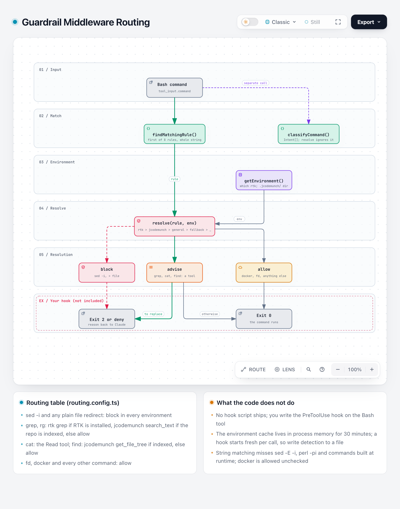

# Guardrail Middleware Example

A simplified implementation demonstrating tool routing and intent classification for token-optimized agent behavior.

This is a single-language (TypeScript) example for the optional [L3: Optimization](../../docs/L3-optimization.md) layer. It illustrates Pattern 3.1, Prefer Native Structured Tools; Block Destructive Edits.

## Overview

This example shows the core routing logic:

1. **Intent Classification** — Parse bash commands to detect what the agent is trying to do
2. **Environment Detection** — Check available tools (RTK, jcodemunch) at session start
3. **Native Structured Tool Routing** — Route commands to the native or structured tool for the job, based on intent + environment
4. **Resolution** — Return `allow`, `advise` (use different tool), or `block`

## Architecture



## File Structure

```
src/
├── core/
│   ├── intent.ts        # Intent classifier (command → intent)
│   ├── router.ts        # Router (intent + env → resolution)
│   └── environment.ts   # Environment detector (RTK, jcodemunch)
└── config/
    └── routing.config.ts # Data-driven routing rules
```

## Usage Example

```typescript
import { classifyCommand } from './core/intent.js';
import { getEnvironment } from './core/environment.js';
import { resolve } from './core/router.js';
import { findMatchingRule } from './config/routing.config.js';

// Agent issues a command
const command = 'grep -r "export.*function" ./src';

// 1. Classify intent
const intents = classifyCommand(command);
// → ['text_search']

// 2. Detect environment
const env = await getEnvironment('/path/to/project');
// → { rtkAvailable: true, jcodemunchIndexed: true, ... }

// 3. Find matching rule and resolve
const rule = findMatchingRule(command);
const resolution = resolve(rule!, env);
// → { action: 'advise', tool: 'rtk grep', reason: '...' }

// 4. Apply resolution
if (resolution.action === 'advise') {
  // Agent re-routes to advised tool
} else if (resolution.action === 'block') {
  // Agent stops, explains why
} else {
  // Proceed with original command
}
```

## Build and Test

Requires Node.js 22 or later (the test script passes a quoted glob to `node --test`).

```bash
npm ci
npm test        # runs `npm run build` (tsc) first, then node:test on dist/**/*.test.js
```

Tests live in `src/__tests__/`. They cover intent classification, environment-aware resolution, the docker default-allow rule, and the known string-matching bypasses. Environment detection (`detectEnvironment`) shells out to `which rtk` and has no injectable seam, so the tests exercise `resolve()` with hand-built `Environment` values instead.

### String matching is a nudge, not a control

The classifier (`src/core/intent.ts`) and the router (`src/config/routing.config.ts`) use different patterns for `sed -i`:

- The classifier is anchored to the start of each segment (`^\s*sed\s+(-i|--in-place)\b`). It misses `/usr/bin/sed -i` and `sed -E -i`.
- The router rule is unanchored (`\bsed\s+(-i|--in-place)\b`). It catches `/usr/bin/sed -i` but also blocks harmless text such as `echo sed -i` (false positive). It misses `sed -E -i`.
- Neither matches `perl -pi`, `python -c` file writes, or commands assembled at runtime (`$(echo sed) -i ...`).

Use a containment boundary for limits that must hold.

## Intent Types

A rule's resolution depends on the environment. The router returns the first of `rtk` (if RTK is installed),
`jcodemunch` (if the repository is indexed), `general`, `fallback` and `_` that the rule defines. `fallback` is
reached only by a rule with no `general` entry, so for the rules below it never applies.

| Intent | Matches | Resolution |
|--------|---------|------------|
| `file_read` | `cat <file>` (the classifier also labels `head` and `tail`, which have no router rule and pass through) | advise the Read tool |
| `text_search` | `grep`, `grepr`, `grepx`, `rg` | `rtk`: advise `rtk grep`; `jcodemunch`: advise `jcodemunch search_text`; `general`: advise the Grep tool |
| `file_discovery` | `find`, `fd` | `jcodemunch`: advise `get_file_tree` (`find` only); `general`: advise the Glob tool |
| `file_modify` | `sed -i`, `sed --in-place`, `awk` with a redirect | block in every environment |
| `docker` | `docker`, `docker-compose` | allow |
| `pass_through` | everything else | allow |

The `general` advice names Claude Code's Grep and Glob tools. On macOS, Linux and WSL Claude Code leaves both out
of the default tool set and runs `grep` and `find` through Bash (see the
[tools reference](https://code.claude.com/docs/en/tools-reference)). Change the `tool` names in
`routing.config.ts` to the tools your session has, or the advice points at a tool that does not exist.

### Docker is default-allow

The router allows every `docker` and `docker-compose` command (`src/config/routing.config.ts`, intent
`docker`). It does not inspect subcommands or flags, so `docker run -v /:/host` and `docker exec` pass. Access
to the Docker socket is root-equivalent on the host. Treat this rule as a statement that no dedicated tool
exists for Docker commands, not as a security control. Restrict Docker access with a containment boundary
(sandbox, credential scope); see [Pattern 2.9 — Contain Before You
Relax](../../docs/L2-behavioral-guardrails.md#pattern-29--contain-before-you-relax).

## Routing Rules

Rules are defined in `src/config/routing.config.ts`. Each rule specifies:

- **Pattern**: RegExp to match commands
- **Intent**: Classification type
- **Resolutions**: Per-environment actions (rtk, jcodemunch, general, fallback)

Example rule for `grep`:

```typescript
{
  match: /\b(grep[rx]?|rg)\b/,
  intent: 'text_search',
  resolutions: {
    rtk: { action: 'advise', tool: 'rtk grep', reason: 'structured output, filtered results' },
    jcodemunch: { action: 'advise', tool: 'jcodemunch search_text', reason: 'indexed search, faster' },
    general: { action: 'advise', tool: 'Grep tool', reason: 'structured results, no artifacts' },
    fallback: { action: 'allow' },
  },
}
```

## Integration with Claude Code

This example has no hook script. To use the middleware in Claude Code, register a `PreToolUse` command hook on
the `Bash` tool. Claude Code passes the tool call as JSON on stdin; the command is in `tool_input.command`
([hooks guide](https://code.claude.com/docs/en/hooks-guide)). The hook:

1. Reads the JSON and extracts `tool_input.command`.
2. Runs `findMatchingRule(command)` and `resolve(rule, environment)`. Detect the environment once per session
   and cache it, because the hook process starts fresh for each call.
3. For `block`, and for `advise` when the advised tool should replace the command, exits 2 with the reason on
   stderr, or exits 0 with JSON `{"hookSpecificOutput": {"hookEventName": "PreToolUse", "permissionDecision":
   "deny", "permissionDecisionReason": "<reason>"}}`. Claude Code cancels the call and returns the reason to
   Claude, which then uses the advised tool.
4. For `allow`, exits 0 with no output.

[Pattern 2.3](../../docs/L2-behavioral-guardrails.md#pattern-23--hook-automation) shows a complete hook script and the exit-code contract.
A hook that crashes or exits with a code other than 0 or 2 does not block the call unless it is configured to
(`onFailure: "block"`), so a hook that must hold needs that setting and a test that shows the block.

## Adapting for Other Projects

1. **Custom Intents**: Add new intent types to `intent.ts`
2. **Custom Tools**: Extend routing rules in `routing.config.ts`
3. **Custom Environment Checks**: Add detectors in `environment.ts`
4. **Custom Resolutions**: Define new resolution actions beyond allow/advise/block

## Token Savings

Savings depend on the repository, the query, and the tools installed. Measure them in tokens on your own sessions before relying on any figure.

## Further Reading

- [L3 Optimization Documentation](../../docs/L3-optimization.md)
- [RTK](https://github.com/rtk-ai/rtk) — Token-optimized CLI proxy
- [jcodemunch](https://github.com/jgravelle/jcodemunch-mcp) — Codebase indexing

RTK proxies your shell commands and jcodemunch is an MCP server that indexes your repository. Treat both as
dependencies: read the source before installing and pin a version ([Pattern
2.12](../../docs/L2-behavioral-guardrails.md#pattern-212--skill-plugin-and-mcp-supply-chain)). jcodemunch is
free for non-commercial use; commercial use needs a paid license.
